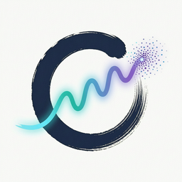

# 妙绘工作台 (MiaoDraw)



标准桌面客户端的 AI 图像 / 视频创作平台，阿里云百炼 API 驱动。Electron + React + Ant Design，工程架构对齐 electron-vite 标准脚手架。

## 功能

- **创作**：文生图 / 图生图 / 多素材融合（wan2.7 系最多 9 张参考图，qwen-image 3 张），模型与尺寸可选，种子复现，负面提示词
- **画布工作台**：无限画布 + 节点 + 连线 + 计划卡 + 对话面板（说一句需求 → 自动搭多阶段工作流，逐阶段闸门确认后可重排/冻结）
- **合成画布**：Konva 图层拼合、蒙版 / 智能抠图、导出成品
- **灵感库**：内置提示词案例（含示例图），分类 / 搜索 / 分页，一键"用提示词创作 / 以此图作参考 / 蒸馏"
- **提示词反推**：本地 transformers 离线反推（图片不出本机），也可走 qwen3-vl-plus 云端视觉模型
- **历史记录**：本地作品回看、保存、打开位置、一键复现（含素材内容寻址留档还原）
- **视频成片（V1）**：文案 → 分镜出图 → 配音 → ffmpeg 合成，含成本预估、一次性确认凭证与续跑
- **成本护栏**：图片 / 改图 / Agent 共用预算闸门；视频另有一整套 fail-closed 闸门（详见下）

## 前置条件

在应用内填一次密钥即可：**设置 → 模型服务 → 百炼密钥**，粘贴百炼 API Key（`sk-` 开头）或 Token Plan 订阅密钥（`sk-sp-` 开头）。

- 密钥经 Electron safeStorage（Windows DPAPI）加密后保存在本机 `settings.json`，运行时只注入子进程环境变量 `DASHSCOPE_API_KEY`，不写入 `~/.bailian`
- **不需要安装 bailian-cli**：引擎是纯 HTTP 直连 DashScope（见 `src/main/http.ts`），旧的 CLI 内置方案已在 b0490e8 移除
- 除百炼外也支持第三方 OpenAI 兼容供应商（硅基流动 / OpenAI / 自定义 baseUrl），密钥分开管理

> Token Plan 订阅密钥会被自动识别并路由到订阅端点；订阅未包含的模型会返回明确错误提示。

## 运行

```cmd
start.cmd
```

或手动：

```cmd
npm install
npm run dev      &rem 开发模式（HMR 热更新）
npm run app      &rem 类型检查 + 构建 + 启动
```

## 打包安装程序

```cmd
npm run build:win
```

产物：`miaodraw-setup-<version>.exe`（NSIS）与 `miaodraw-portable-<version>.exe`（免安装单文件）。
`library/` 素材经 extraResources 随包分发；`productName` 保持 ASCII（`MiaoDraw`）以规避 NSIS / 更新链路的非 ASCII 文件名问题。

## 架构

```
┌────────────────────────────────────────────┐
│ Electron 主进程  src/main                    │
│  · HTTP 直连百炼（生图 / 改图 / 对话 / 视频）  │
│  · 编排状态机    orchestrator/                │
│  · 视频管线      video/                       │
│  · 提示词质量层  prompt-guards.ts             │
│  · media:// 协议：安全读取本地图片             │
│  · IPC 通道 + 截图验收探针（SHOT_*）           │
├────────────────────────────────────────────┤
│ 预加载脚本        src/preload                 │
│  · contextBridge 暴露 window.api              │
├────────────────────────────────────────────┤
│ 渲染进程         src/renderer                 │
│  · React 19 + Ant Design 5（浅色 · Apple 风 token） │
│  · 创作 / 画布工作台 / 合成 / 灵感库 /          │
│    提示词反推 / 历史 / 设置                    │
└────────────────────────────────────────────┘
              │ HTTPS（fetch，无本地服务）
              ▼
      DashScope API（原生协议 + OpenAI 兼容双路）
```

- **零本地 HTTP 服务**：渲染进程只经 IPC 与主进程通信；图片走自定义 `media://local/{out,vid,lib-a,lib-b}/` 协议（带目录逃逸校验）
- **数据落点**：`outputs/` 产物（同名 `.json` sidecar）、`refs/` 内容寻址留档、`videos/` 成片与中间件；渲染层 IndexedDB 8 张表（schema v5）
- **案例库**：`library/`（libA 精选 md 案例 + libB 全能 json 案例），打包时经 extraResources 随应用分发
- **验收探针**：`npm run shot`（构建 + 截图退出）；`SHOT_VIEW=library|distill|history`、`SHOT_GEN=1`、`SHOT_CANVAS=1`、`SHOT_PLAN_CHAT=1` 等 40+ 个 `SHOT_*` 开关可做分页面 / 全链路零成本验收
  - 探针使用**独立 profile**（`%APPDATA%/miaodraw-shot`，默认每次运行重置，可用 `SHOT_KEEP_PROFILE=1` 保留现场 / `SHOT_PROFILE_DIR` 指定目录），不会读写正式作品数据

## 成本护栏

- **图片链路**（`src/main/image-cost.ts`）：预算 `imageBudget`（默认 ¥20）+ 已花 `imageSpentCny`，超预算直接拒绝、**不发起任何付费请求**；设置页「成本护栏」可查看 / 调整 / 重置
- **视频链路**：单次 ¥6 硬上限 → 预算账本 → 一次性 `confirmToken`（绑 stageId + revision + 付费项哈希，用后作废）→ 三键幂等 job → 失败 2 次自动 blocked → 下载 https + 阿里云域白名单 + `.part` 原子落盘

## 配置

| 位置 | 说明 |
|---|---|
| `%APPDATA%/miaodraw/settings.json` | 模型默认值、尺寸、密钥密文、`imageBudget` / `imageSpentCny`、`videoBudget`、自定义更新源 |
| `src/main/http.ts` | 协议分发与各模型请求构造（能力表 `imageCapability`） |
| `src/renderer/src/models.ts` | 模型清单、价格标注、素材张数上限（与主进程能力表需同步） |
| `src/renderer/src/views/CreateView.tsx` | 创作页可选项 |

## 测试

```cmd
npm test
```

Node 原生 `node --test`，直接跑 `.ts` 源码（依赖 Node ≥ 22.18 的 type stripping），共 5 组：

| 组 | 覆盖 |
|---|---|
| `test:canvas` | 连线几何命中（1/k 补偿）、冻结区判定、计划异常恢复 |
| `test:orchestrator` | 阶段状态机、注册表（冻结前缀 / 幂等 / CAS / 阶段接力 / 重启恢复） |
| `test:prompt` | 提示词质量层（失败卡 / 厂商卡 / 保真 / 编造事实） |
| `test:video` | 视频协议、作业幂等、成本闸门、主链纯函数 |
| `test:cost` | 图片成本护栏（预估价 / 预算 fail-closed） |

## 旧版说明

`../qwen-workbench-demo/` 为早期 Python + ComfyUI 方案，已被本项目取代，仅作历史参考。
Pixelle-Video 后端已彻底停用（改为直连百炼），相关文件与目录只保留历史资产的只读兼容。
